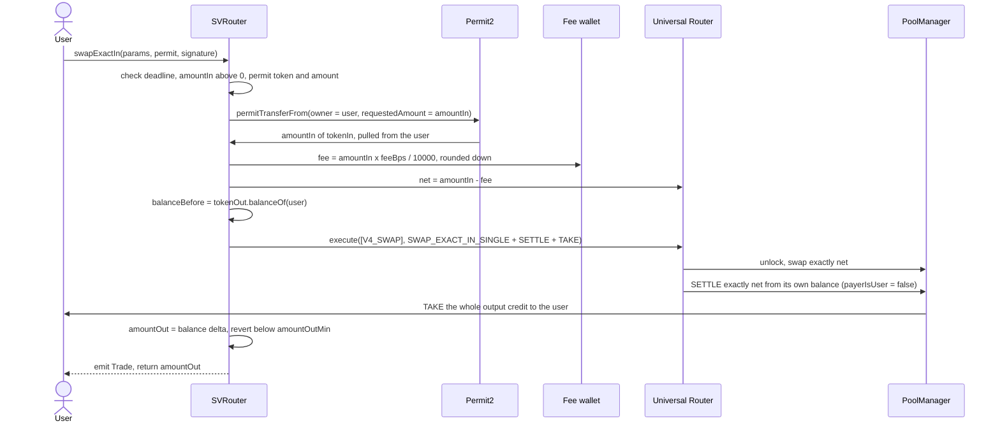
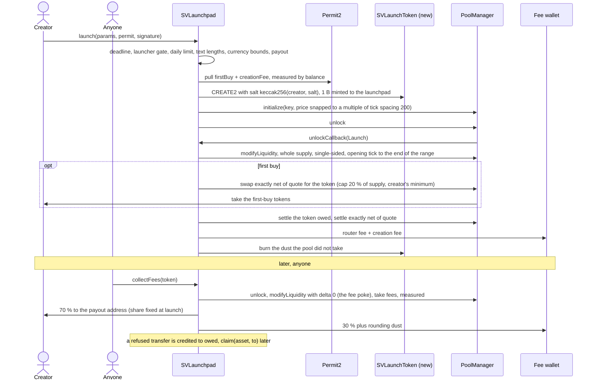

# MaxLong Markets contracts: SVRouter and SVLaunchpad

The on-chain half of [MaxLong Markets](https://www.maxlong.markets), a stock-paired memecoin market on Robinhood
Chain (chain id 4663, an Arbitrum Orbit L2) built by Kobs for the client MAXLONG. There are two contracts.
`SVRouter` is the only way the app trades. It pulls the input token through Permit2, keeps a 0.5 % fee in the input
token, and forwards one exact-input Uniswap v4 swap to the Universal Router, which pays the output straight to the
user. `SVLaunchpad` launches a token in one transaction. It deploys a 1 B-supply token by CREATE2 and opens its v4
pool at the valuation the creator picks. It places the whole supply in one single-sided position that no code can
withdraw, optionally buys the creator a first allocation, and splits the position's 1 % pool fees 70/30 between
creator and platform. Foundry, Solidity 0.8.26, Cancun. Both contracts are deployed. Neither has been audited
externally.

## What is live

| Contract | Address on Robinhood Chain | Deployed | Settings at deploy |
|---|---|---|---|
| `SVRouter` | [`0xc9E6b76aA834e746080b1F8Ad6943930eD5147a9`](https://robinhoodchain.blockscout.com/address/0xc9E6b76aA834e746080b1F8Ad6943930eD5147a9) | 18 Sep 2026 | `feeBps` 50, `holderFeeBps` 0, `MAX_FEE_BPS` 50, `suitsNft` zero |
| `SVLaunchpad` | [`0x7885AFbda28F5a4d5c6Cc4230975c983d6c7aA0d`](https://robinhoodchain.blockscout.com/address/0x7885AFbda28F5a4d5c6Cc4230975c983d6c7aA0d) | 29 Sep 2026 | router fee 50 bps, creator share 7,000 bps, first-buy cap 2,000 bps, 5 launches per wallet per day, no hook, 54 currencies, launcher gate the Suits NFT |

| Counterparty | Address |
|---|---|
| Uniswap v4 PoolManager | `0x8366a39CC670B4001A1121B8F6A443A643e40951` |
| Universal Router (2.1.1 build, fingerprinted, see below) | `0x06AfBA43Fd06227fA663b0DAecF536f6EaA6bf99` |
| Permit2 (canonical) | `0x000000000022D473030F116dDEE9F6B43aC78BA3` |
| The Suits NFT (ERC-721, launcher gate) | `0x05c2174aa494bbdf72aeeab0ca3c10216d33b297` |

The rest of the system is in the [workspace repo](https://github.com/maxlong-markets/suitventures-markets), which
holds the system README and the Decision Log (the D-numbers below), and in the
[frontend repo](https://github.com/maxlong-markets/suitventures-markets-frontend): the Next.js app, the chain reader
that indexes these contracts' events, and the launchpad spec.

## Architecture

### `swapExactIn`



The router never holds a token after a swap and never grants an allowance. A partial fill cannot strand input
inside the Universal Router: settling exactly `net` leaves a non-zero delta, and the PoolManager rejects the unlock.

### `launch` and fee collection



The position is owned by the launchpad. The only two `modifyLiquidity` calls in the contract are the mint and
the zero-delta poke, so no code path, the owner's included, can take liquidity out. An invariant test checks this.

## Engineering decisions worth reading

**Fingerprinting the deployed Universal Router to pin the libraries.** *Problem:* the router at `0x06Af…bf99` has
no version label. v4-periphery changed `ExactInputSingleParams` from five fields to six (`minHopPriceX36`) in March
2026, and a struct of the wrong shape reverts with empty data. *Chosen:* identify the build from its bytecode. It
contains the selectors of `executeSigned` and `signedRouteContext` (added in universal-router 2.1.1) and of
`V4TooLittleReceivedPerHop`, `V4TooLittleReceivedPerHopSingle` and `InvalidHopPriceLength` (v4-periphery,
2026-03-17). It lacks `V4ExactOutputUnfilled` (2026-08-03) and the 2.2.0 permissioned-router surface. A read-only
`eth_call` with the six-field struct decoded and ran the swap, reverting `V4TooLittleReceived(uint128.max, …)`; the
five-field struct reverted with empty data. *Why:* the encoding has to match what is deployed, not the latest
release. *Cost:* v4-periphery is pinned to an untagged commit, `3231810e`, and the router address is immutable, so
a new Universal Router means a new SVRouter.

**EIP-170 size pressure, solved per file.** *Problem:* SVLaunchpad embeds SVLaunchToken's creation code for
CREATE2. At the repo's 1,000,000 optimizer runs it is 31,328 bytes, over the 24,576-byte limit. SVRouter was
already deployed at that setting. *Chosen:* a second compiler profile at 200 runs, applied only to
`src/SVLaunch*.sol` through `compilation_restrictions` ([`foundry.toml`](foundry.toml)). *Why:* SVRouter's bytecode
stays byte-for-byte what was deployed, and no via-IR or library split was needed. *Cost:* two optimizer settings
to verify with, slightly higher launch gas, and 287 bytes of headroom (24,289 bytes). The coverage profile has to
clear both keys.

**The real Permit2 in unit tests.** *Problem:* Permit2's sources pin solc 0.8.17 exactly, and this project pins
0.8.26. A mock Permit2 would test the signature path against itself. *Chosen:* the test fixture etches Permit2's
deployed bytecode at its canonical address through `lib/permit2/test/utils/DeployPermit2.sol`, as Uniswap's
periphery tests do. Permits are signed with `vm.sign` over the real EIP-712 digest
([`test/utils/Permit2Signer.sol`](test/utils/Permit2Signer.sol)). *Why:* signatures, nonces and deadlines are
enforced by production code, and the fork tests talk to the same address. *Cost:* a bytecode blob in the fixture
instead of steppable source.

**Refusing hook flags instead of trusting the owner's hook.** *Problem:* a v4 hook's powers are encoded in the low
bits of its address. The launchpad's fee poke is a zero-delta remove-liquidity, so a hook with a remove-liquidity
flag could freeze `collectFees` for every launch made under it. A returns-delta hook could skim the mint, the
collection or any trade, the first buy included. *Chosen:* `setHook` refuses a codeless hook, a hook v4 rejects for
a static fee, both remove-liquidity flags and all four returns-delta flags, as one bitmask
(`SVLaunchpad.sol:78-81`, `:612-621`). An internal security review on 29 Sep 2026 added the last four flags. *Why:* an
anti-snipe hook needs none of them, and a pool's hook is fixed in its key forever. *Cost:* a hook that needs a
dynamic fee or a delta needs a new launchpad.

**Output measured as the user's balance delta.** *Problem:* listed pools carry hooks (MemeHook takes 1 % of the
output after the swap), and output tokens may tax transfers. *Chosen:* `amountOut` is `tokenOut.balanceOf(user)`
after minus before, checked against `amountOutMin`, and that is the figure the `Trade` event reports. *Why:* the
event and the slippage bound describe what reached the wallet, not what the pool computed. The Universal Router
enforces the same minimum on the swap delta and, on the fork, always reverts first (`V4TooLittleReceived`), so this
check is a backstop that costs two `balanceOf` calls. *Cost:* a hostile output token can misreport its own balance,
which only misleads the person who chose to buy it.

Two smaller choices follow the same rule of failing closed. `SETTLE` pays exactly `net` rather than the open delta,
a change made after an internal security review on 17 Sep 2026 showed the open delta would leave a partial fill's
remainder sweepable in the Universal Router. And every quote pull and fee take in the launchpad is measured, so a
fee-on-transfer token can never spend balances credited to someone else.

## Security

[`SECURITY.md`](SECURITY.md) has the full review: scope, threat model, the controls table with line references, and
15 findings (no Critical or High; one Medium, the single-EOA owner, open until the ownership handoff completes).
The short version:

- Funds are only ever in flight. The router holds nothing between transactions. The launchpad holds only credited
  `owed` shares, and an invariant test asserts its balance equals their sum.
- Owner powers are capped in code. Fees are at most 0.5 %. The owner cannot withdraw locked liquidity, cannot touch
  `owed`, cannot change an existing launch's share or hook, and cannot renounce.
- Hostile tokens, hooks and NFTs fail closed. `nonReentrant` guards every entry point that moves funds, the holder
  and gate checks are gas-capped raw static calls, and fee-on-transfer inputs revert.

**Accepted risks, signed off as design decisions:**

| Risk | What it means | What limits it |
|---|---|---|
| Hook set by the owner | Every launch made while a hook is set gets that hook in its pool for good; a pool never changes its hook | Move ownership to MAXLONG's Safe. The frontend refuses to launch while `hook()` is not zero. `setHook` refuses any hook with a remove-liquidity flag, which could block fee collection, or a returns-delta flag, which could change what a trade or the position pays |
| No on-chain bound at launch | A launch takes the creator share and hook in force when it lands. The launch call carries no expected values for them | The creator is protected by what the form reads just before signing, the exact Permit2 amount, and `minFirstBuyTokens` |
| A quote that pauses or blocklists | If a currency pauses transfers or blocklists the launchpad, collection freezes for both currencies of every launch in that currency | Only currencies the owner allows can be used, so the allowlist is trusted |
| A hostile quote | A quote that burns gas or sends a huge reply can make a collection revert | The same trusted allowlist |
| Front-run griefing | Anyone can pre-initialise a pending launch's pool key, so the launch reverts; the creator loses gas only | Random salt, a sequencer with no public mempool, the form retries with a new salt (spec 4.10) |
| Spot holder rate | With an NFT configured, a borrowed Suits NFT pays the holder rate for one transaction | Inactive: `suitsNft` is zero, so everyone pays 0.5 % (D34) |
| Rounding dust | Each collection rounds the creator's share down, and the remainder goes to the fee wallet | Less than one raw unit per currency per collection |
| No external audit | The contracts are reviewed and tested here, not audited by an outside firm | 100 % coverage on `src/`, fuzz, invariant and fork tests |

## Testing

194 test functions: 183 offline in 12 suites, plus 11 fork tests against Robinhood Chain. Measured on 27 Oct
2026:

| Check | Result |
|---|---|
| `forge test --no-match-path 'test/fork/*'` | 183 passed, 0 failed, 0 skipped |
| Fuzz | 6 properties at 256 runs: fee arithmetic, the fee and net split of a full trade, opening-price snapping, launches across the valuation range, the first buy against the curve to a relative 1e-9, the fee split |
| Invariants | 2, at 64 runs x 256 depth (16,384 calls each): the launchpad's balance equals the sum of `owed`; the position's liquidity never changes after launch |
| Coverage of `src/` | 100 % lines, statements, branches and functions on all three contracts (SVRouter 71/71 lines, 11/11 branches; SVLaunchpad 298/298 lines, 50/50 branches) |
| Sizes | SVLaunchpad 24,289 bytes, SVRouter 7,647, SVLaunchToken 1,969 |
| Gas of a launch with a first buy | 1,139,019 (unit suite) |
| `forge fmt --check`, `forge lint src script` | clean |
| Fork suites (not re-run for this README) | SVRouter 9/9 at block 65,241,000; SVLaunchpad 2/2 at block 75,238,414 |

What they prove. The unit suite runs a real v4 PoolManager deployed locally and the real Permit2 bytecode. Only the
Universal Router is mocked, and `MockUniversalRouter` decodes the real command and action encodings and records
every field, so an encoding regression fails a named test. Quirky tokens (fee-on-transfer, false-returning,
no-return-data, refusing chosen recipients), gas-burning and short-reply NFTs, and a `beforeSwap` hook have their own mocks. The SVRouter fork
suite trades the three real pools in both currency orders through the deployed Permit2 and Universal Router,
and the V4 Quoter agrees to the wei. The launchpad fork suite launches in USDG and NVDA and trades through
SVRouter. `uncollectedFees` matches StateView there, which proves the PoolManager's storage layout.

CI ([`.github/workflows/ci.yml`](.github/workflows/ci.yml)) runs the size build, `forge fmt --check` and the
offline suite on every push and pull request.

## How to run

```sh
git clone --recurse-submodules https://github.com/maxlong-markets/suitventures-markets-contracts
cd suitventures-markets-contracts
forge build --sizes --skip test --skip script        # the test PoolManager is over EIP-170, so tests are skipped here
forge test --no-match-path 'test/fork/*'             # offline, no .env needed
FOUNDRY_PROFILE=coverage forge coverage --report summary --no-match-path 'test/fork/*'
forge fmt --check
ROBINHOOD_RPC_URL=https://rpc.mainnet.chain.robinhood.com ROBINHOOD_FORK_BLOCK=<a recent block> \
  forge test --match-path 'test/fork/*' -vv          # needs recent state, see docs/deploy.md
```

Foundry is the only tool (forge 1.4 nightly on the build machine); forge downloads solc 0.8.26. Environment
variables, the deploy and verify commands, the launchpad's currency config and the fork-state window are in
[`docs/deploy.md`](docs/deploy.md).

## How to review

Read in this order.

1. **The router spec (15 min):** [`docs/superpowers/specs/2026-09-17-svrouter-design.md`](docs/superpowers/specs/2026-09-17-svrouter-design.md). Sections 3 to 5 are the requirements, 6a the implementation choices made during the build, 7 the accepted risks.
2. **The router (45 min):** `src/SVRouter.sol`, top to bottom, against the spec rule each line implements.

   | Spec rule | Where |
   |---|---|
   | The fee can never exceed 0.5 %; deploy values 50 and 0 | `MAX_FEE_BPS` line 41, constructor lines 88 to 102, `setFees` bounds line 209 |
   | Universal Router and Permit2 are fixed at deploy | immutables lines 55 and 58; the deploy script refuses any address but the spec's unless told otherwise |
   | Checks before any funds move: deadline, non-zero amount, permit matches the input token and amount | lines 128, 129, 135 |
   | Permit2 pulls exactly `amountIn` into the router | line 138 |
   | Fee on the input, rounded down, holder rate when a Suits NFT is held; a bad NFT address can never block a trade | `feeFor` lines 182 to 189, static call with a 100,000 gas allowance at line 185 |
   | Fee to the fee wallet, net to the Universal Router, no allowance ever granted | lines 151 to 153 |
   | One Universal Router call: exact-input single swap, settle the exact net, take to the user | `_executeSwap` lines 263 to 290, action bytes from the libraries at line 270 |
   | Output measured as the user's balance delta; below the minimum reverts | lines 157 to 163 |
   | One `Trade` event with gross input, fee, output and the rate used | line 166 |
   | Owner can change the wallet, lower or raise the fee within the cap, set the NFT, sweep a stray token; never renounce | lines 199 to 238 |
   | Reentrancy | `nonReentrant` on `swapExactIn` line 122 |

3. **The router tests (30 min):** `test/unit/SVRouter.t.sol` is grouped by concern (constructor, setters, ownership, `feeFor`, trades in both directions, every revert, holder rates, the four wrong-NFT cases, `sweep`). `SVRouter.fuzz.t.sol` fuzzes the fee arithmetic and a full trade, and `test/fork/SVRouterFork.t.sol` covers the real pools, a holder paying no fee, both revert paths, and an oversized swap reverting with nothing left in the Universal Router. Coverage at the time: [`docs/review/2026-09-17-coverage.md`](docs/review/2026-09-17-coverage.md).
4. **The launchpad:** the frontend repo's [launchpad spec](https://github.com/maxlong-markets/suitventures-markets-frontend/blob/main/docs/superpowers/specs/2026-09-28-instant-launchpad-design.md), sections 3 and 4, then `src/interfaces/ISVLaunchpad.sol`, then `src/SVLaunchpad.sol` from `launch` down; the step numbers in its comments are the spec's.
5. **The launchpad tests:** `SVLaunchpad.launch.t.sol`, `SVLaunchpad.fees.t.sol`, `SVLaunchpad.invariant.t.sol`, `SVLaunchpad.fuzz.t.sol`, `test/fork/SVLaunchpadFork.t.sol`.

Review decisions as deployed. The holder rate stays at 0 bps, but no NFT is set on the router, so the perk is off
(D34). `sweep` stays, for tokens sent to the router by mistake. Swaps are exact input only: the app quotes
exact-output requests with the Quoter and executes exact input. The NFT static call keeps its 100,000-gas
allowance.

## How the Universal Router call is built

`swapExactIn` makes one call, `execute(commands, inputs, deadline)`, with `commands = [Commands.V4_SWAP]` and
`inputs = [abi.encode(actions, params)]` where `actions = [SWAP_EXACT_IN_SINGLE, SETTLE, TAKE]`:

| Action | Params | Meaning |
|---|---|---|
| `SWAP_EXACT_IN_SINGLE` | `IV4Router.ExactInputSingleParams{poolKey, zeroForOne, amountIn = amountIn - fee, amountOutMinimum = amountOutMin, minHopPriceX36 = 0, hookData}` | the swap; `minHopPriceX36 = 0` switches the router's optional per-hop price floor off, `amountOutMin` is the bound |
| `SETTLE` | `(currencyIn, net, payerIsUser = false)` | pay exactly the net amount from the tokens the Universal Router already holds, which the router sent it; if the pool consumed less (a partial fill), the PoolManager rejects the unlock and the whole call reverts, so no input is ever left inside the Universal Router |
| `TAKE` | `(currencyOut, user, OPEN_DELTA)` | send the whole output credit straight to the user |

The command byte and the action bytes are the constants of the installed `universal-router` (`Commands.sol`) and
`v4-periphery` (`Actions.sol`, `ActionConstants.sol`) libraries; nothing is hand-written. The libraries match the
deployed router build, fingerprinted on 17 Sep 2026 at block 65,188,720 as described under the engineering decisions.

## Dependencies

Git submodules under `lib/`, pinned by commit (`foundry.lock` holds the same pins). `auto_detect_remappings` is
off, so only `remappings.txt` applies and every Uniswap type resolves to one copy, the root submodule, even
though the dependencies carry their own nested `lib/` trees.

| Library | Ref | Commit | Why this one |
|---|---|---|---|
| `foundry-rs/forge-std` | `v1.9.7` | `77041d2ce690e692d6e03cc812b57d1ddaa4d505` | latest v1.9 |
| `OpenZeppelin/openzeppelin-contracts` | `v5.7.0` | `cab19933c33c2ad1d4c7a84864a3601dddfd16f3` | latest v5 (`Ownable2Step`, `ReentrancyGuard`, `SafeERC20`, `ERC20`, `Create2`, `TransientSlot`) |
| `Uniswap/v4-core` | `v4.0.0` | `e50237c43811bd9b526eff40f26772152a42daba` | the release tag (`PoolKey`, `Currency`, `PoolId`, `TickMath`, `StateLibrary`). v4-periphery's own pin is `59d3ecf5`, whose only source change since is the build-dependency refactor #964 (two structs moved to `types/PoolOperation.sol`), which nothing here imports |
| `Uniswap/v4-periphery` | commit | `3231810e39b8c4d569b9d66907fa4ef8cd2cec22` | the commit universal-router 2.1.1 pins (2026-03-17); six-field `ExactInputSingleParams`, no later changes; `LiquidityAmounts` for the launchpad |
| `Uniswap/universal-router` | `2.1.1` | `999d561c3ad58fb5cab91b602911f3c75591a9c7` | the release the deployed router matches; `Commands.V4_SWAP`, `IUniversalRouter` |
| `Uniswap/permit2` | main | `cc56ad0f3439c502c246fc5cfcc3db92bb8b7219` | the commit the Universal Router pins; the contract sources are those of the deployment tag, later commits only touched interface pragmas, docs and test utilities |

`solmate/` is remapped to v4-core's nested copy so the tests can deploy a local `PoolManager`; CI therefore checks
out submodules recursively.

## Scope and status

- **Built and deployed:** SVRouter (18 Sep 2026) and SVLaunchpad (29 Sep 2026), both wired into the live app.
- **Not externally audited.** The evidence is the review in [`SECURITY.md`](SECURITY.md) and the test suites above.
- **Ownership transfer pending.** Both contracts are owned by the developer's EOA; the move to MAXLONG's wallet is
  a two-step `transferOwnership` and `acceptOwnership` and is the remaining handoff step.
- **Deferred:** the presale launchpad (a fixed-price raise with refunds) is planned in
  [`docs/superpowers/plans/2026-09-27-launchpad-contracts.md`](docs/superpowers/plans/2026-09-27-launchpad-contracts.md)
  and kept as phase two. Not built.
- **Out of scope on purpose:** native ETH on either side, exact-output and multi-hop swaps, a pause switch,
  anti-snipe hooks, an on-chain creation-fee cap. The launcher gate is set by the owner: at deploy it was the Suits
  NFT, and the Decision Log (D47, 9 Oct 2026) records that it still restricted creation to Suits holders while the
  app itself went public.
- **Known limitations:** 287 bytes of EIP-170 headroom on the launchpad; fork tests need an RPC with recent state;
  the router deploy script has no unit test (it ran once, for the real deployment).
- **Do not expect:** upgradeability (neither contract is a proxy), a way to withdraw a launch's liquidity, or
  owner rescue of tokens sent to the launchpad.

## Layout

| Path | What it is |
|---|---|
| `src/SVRouter.sol` | the fee router |
| `src/interfaces/ISVRouter.sol` | `SwapParams`, events, errors, external functions (spec section 3) |
| `src/SVLaunchpad.sol` | the instant launchpad |
| `src/SVLaunchToken.sol` | the token every launch deploys: OpenZeppelin ERC-20 with `burn`, no owner |
| `src/interfaces/ISVLaunchpad.sol` | the launchpad's structs, events, errors, external functions (spec section 4.2) |
| `script/Deploy.s.sol` | deploys SVRouter, with chain-id and address guards |
| `script/DeployLaunchpad.s.sol` | deploys SVLaunchpad and allows the config's currencies, every row checked before broadcast |
| `script/config/` | the launchpad's currency config; the only path any script may read |
| `test/unit/` | offline suites: unit, fuzz, invariant, ABI and deploy-script tests |
| `test/fork/` | fork tests against Robinhood Chain, skipped when `ROBINHOOD_RPC_URL` is unset |
| `test/mocks/` | the Universal Router mock that decodes real encodings, quirky tokens, NFTs, gates, a hook, a Chainlink feed |
| `test/utils/Permit2Signer.sol` | EIP-712 signing of `PermitTransferFrom` with `vm.sign` |
| `docs/superpowers/specs/` | the binding SVRouter design |
| `docs/superpowers/plans/` | the build plans: router, instant launchpad, deferred presale |
| `docs/review/` | the router's independent coverage report of 17 Sep 2026 |
| `docs/deploy.md` | environment, deploy, verify, currency config, fork-test notes |
| `SECURITY.md` | the security review |
| `lib/` | dependencies as git submodules, pinned by commit |

## Links

- Live app: https://www.maxlong.markets
- Workspace (system README, Decision Log): https://github.com/maxlong-markets/suitventures-markets
- Frontend, chain reader and launchpad spec: https://github.com/maxlong-markets/suitventures-markets-frontend
- Explorer: https://robinhoodchain.blockscout.com
